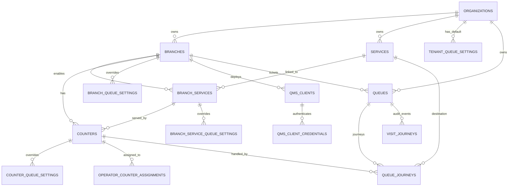
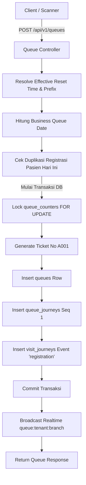
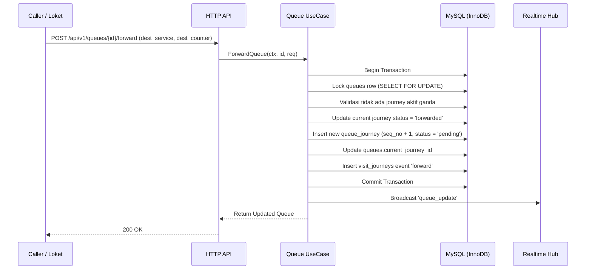

# QMS Architecture Single Source

Dokumen ini menjadi referensi tunggal untuk desain dan arsitektur Queue Management System (QMS) rebuild di repositori ini.

Isi:

- Boundary multi-tenant QMS
- Relasi data inti dan ERD lengkap
- Flow runtime antar entitas (Queue lifecycle, Caller, Signage, Scanner)
- Arsitektur Typed Configuration (`counter -> branch_service -> branch -> tenant`)
- Autentikasi perangkat hardware QMS (`qms_clients`) & penugasan petugas (`operator_counter_assignments`)
- Diagram E2E untuk validasi dan testing

Referensi ini disusun dan disinkronkan langsung dari live wiring repositori: `internal/config/app.go`, `internal/router/router.go`, dan modul QMS aktif di `internal/modules/*`.

---

## 1. Scope Runtime & Modul Aktif

Ekosistem QMS aktif di backend terdiri dari **9 modul domain**:

1. **`organization` (Tenant & Branch)**: Profil multi-tenant organisasi dan hierarki cabang operasional (`branches`).
2. **`service`**: Master katalog layanan (`services`) serta relasi aktivasi cabang (`branch_services`).
3. **`counter`**: Loket / bilik pelayanan fisik per cabang (`counters`), terikat opsional ke `branch_services`.
4. **`queue_config`**: Typed configuration runtime menggantikan tabel generik settings lama (`tenant_queue_settings`, `branch_queue_settings`, `branch_service_queue_settings`, `counter_queue_settings`).
5. **`queue`**: Master tiket harian (`queues`), journey perpindahan layanan (`queue_journeys`), histori event-sourced (`visit_journeys`), alokasi nomor tiket atomik (`queue_counters`), dan broadcast realtime (WebSocket/SSE).
6. **`caller`**: Autentikasi operator pada perangkat pemanggil dan eksekusi transisi status antrean (`call`, `serve`, `complete`, `skip`, `cancel`).
7. **`signage`**: Display TV ruang tunggu/farmasi dengan logo, running text, dan daftar panggilan aktif.
8. **`scanner`**: Mesin kios / pemindai mandiri untuk `register` dan `forward` antrean.
9. **`qms_client` & `operator_assignment`**: Manajemen kredensial perangkat keras QMS (API Key bcrypt) dan penugasan operator ke loket.

**Frontend Konsumen:** `apps/web` (Next.js dashboard pada `/dashboard/*`).

---

## 2. Prinsip Desain Inti

### 2.1 Tenant First (Multi-Tenancy Kuat)
Semua entitas bisnis QMS wajib memiliki kolom `tenant_id` yang divalidasi melalui context database (`database.GetTenantID(ctx)`). Akses antar-tenant dilarang keras (`exception.ErrForbidden` / `exception.ErrNotFound`).

### 2.2 Hierarki Organisasi
```text
Organization (Tenant)
  └── Branch
        ├── BranchService (Link ke Master Service)
        ├── Counter
        ├── Queue (Master Ticket)
        ├── QMS Client (Signage, Caller, Scanner)
        └── Typed Queue Settings (Overrides)
```

### 2.3 Master Queue Single Row & Journey Sequence
`queues` adalah satu-satunya baris master tiket per pasien per hari bisnis.
- **Registrasi**: Membuat 1 baris `queues` + baris awal `queue_journeys` (`seq_no = 1`) + histori `visit_journeys`.
- **Forwarding (Alih Layanan)**: **TIDAK PERNAH** membuat baris `queues` baru. Sistem mengunci master queue (`SELECT ... FOR UPDATE`), menutup journey aktif, dan menambahkan baris baru di `queue_journeys` (`seq_no + 1`).
- **Audit & Histori**: Segala transisi status dicatat sebagai audit di `visit_journeys` secara event-driven.

---

## 3. Live Composition Root & Router Wiring

Arsitektur dependency injection di `internal/config/app.go`:
```text
internal/config/app.go
  ├── NewOrganizationModule / NewBranchModule
  ├── NewServiceModule & NewBranchServiceModule
  ├── NewCounterModule
  ├── NewQueueConfigModule (QueueConfigResolver)
  ├── NewQueueModule (RelationValidator, SettingsResolver, Realtime Hub)
  ├── NewQMSClientModule
  ├── NewOperatorAssignmentModule
  ├── NewCallerModule (QueueUseCase + QMSClientRepo)
  ├── NewSignageModule (QueueRepo + QMSClientRepo + BranchRepo)
  └── NewScannerModule (QueueUseCase + QMSClientRepo)
```

Rute HTTP dipasang di `internal/router/router.go`:
- `/api/v1/tenant/*`, `/api/v1/branches/*`: Profil tenant, cabang, logo direct upload.
- `/api/v1/services/*`, `/api/v1/branches/:id/services/*`: Master layanan, upload audio bell, link branch-service.
- `/api/v1/counters/*`, `/api/v1/branches/:id/counters/*`: Manajemen loket.
- `/api/v1/queue-config/*`: Resolusi konfigurasi efektif (`GET /effective`) dan patch/delete override.
- `/api/v1/queues/*`: Pendaftaran, transisi status, forwarding, daftar journey, statistik harian.
- `/api/v1/caller/*`: Login operator perangkat, info bound context (`/me`), dan aksi antrean.
- `/api/v1/signage/*`: Info display (`/me`), panggilan aktif saat ini, dan daftar tunggu antrean.
- `/api/v1/scanner/*`: Check-in antrean mandiri.
- `/api/v1/qms-clients/*`: Pendaftaran identitas perangkat dan pembuatan API Key.
- `/api/v1/operator-counter-assignments/*`: Penugasan operator ke loket.

---

## 4. Entity Relationship Diagram (ERD)



---

## 5. Struktur Skema Database Utama

### 5.1 `services`
Menyimpan katalog master layanan di tingkat tenant.
- `id`, `tenant_id`, `code`, `name`, `type`
- `default_estimated_duration`: estimasi durasi dalam menit
- `audio_id`, `audio_en`: aset file audio bel / panggilan
- `narrative_instruction_id`, `narrative_instruction_en`: teks instruksi naratif
- `is_pharmacy`, `is_pharmacy_reception`: flag alur farmasi
- `status` (`active` | `inactive`)

### 5.2 `branch_services`
Menghubungkan master layanan ke cabang operasional tertentu.
- `id`, `tenant_id`, `branch_id`, `service_id`
- `custom_name`: nama display khusus cabang
- `is_active`: status aktif operasional di cabang ini
- `sort_order`: urutan tampil di kiosk / signage

### 5.3 `counters`
Loket pelayanan pada cabang.
- `id`, `tenant_id`, `branch_id`, `branch_service_id` (opsional)
- `code`, `name`, `display_name`
- `status` (`active` | `inactive`)

### 5.4 `queues` (Master Tiket)
- `id`, `tenant_id`, `branch_id`, `queue_date` (YYYY-MM-DD)
- `ticket_no` (misal `A001`), `queue_no` (integer urut)
- `patient_id`, `patient_name`
- `status` (`waiting`, `calling`, `serving`, `skipped`, `canceled`, `completed`)
- `current_journey_id`: pointer ke journey aktif

### 5.5 `queue_journeys` (Perjalanan Layanan Tiket)
- `id`, `queue_id`, `tenant_id`, `branch_id`, `service_id`, `counter_id`
- `seq_no` (1, 2, 3...)
- `status` (`pending`, `calling`, `serving`, `skipped`, `canceled`, `completed`, `forwarded`)

### 5.6 `visit_journeys` (Log Event Readable)
- `id`, `queue_id`, `tenant_id`, `branch_id`, `event_type`, `payload` (JSON), `created_at`

### 5.7 Tabel Typed Queue Settings
1. **`tenant_queue_settings`**: Basis default tenant (`queue_reset_time`, `default_ticket_prefix`, `default_estimated_duration`, `numbering_strategy`, `allow_forward`, `allow_skip`, `allow_recall`, `allow_cancel`).
2. **`branch_queue_settings`**: Override di tingkat cabang (nullable).
3. **`branch_service_queue_settings`**: Override di tingkat branch-service (`default_estimated_duration`, `require_counter`, `allow_skip`, `allow_recall`, `allow_cancel`, `allow_forward_from`, `allow_forward_to`, `auto_call_next`).
4. **`counter_queue_settings`**: Override di tingkat loket (nullable).

---

## 6. Resolusi Konfigurasi (Typed Hierarchy)

Hierarki resolusi preferensi paling spesifik:
```text
Counter Override (Level 4)
  └── Branch Service Override (Level 3)
        └── Branch Override (Level 2)
              └── Tenant Default (Level 1)
```

Aturan Bisnis:
1. **Queue Reset Time**: Waktu cutoff pergantian hari bisnis (misal `04:00`). Transaksi sebelum jam reset dicatat ke tanggal bisnis kemarin.
2. **Atomic Counter Allocation**: Penomoran tiket harian menggunakan baris `queue_counters` dengan penguncian `SELECT ... FOR UPDATE` di dalam transaksi database atomik.
3. **Auto Call Next**: Ketika tiket selesai (`complete`), jika konfigurasi `auto_call_next = true`, sistem otomatis memanggil antrean menunggu berikutnya.

---

## 7. Diagram Alur Runtime

### 7.1 Pendaftaran Antrean (Register Flow)


### 7.2 Forwarding Antrean (Alih Layanan)


---

## 8. Verifikasi & Pengujian Kualitas

Prosedur pengujian repositori ini diatur ketat oleh skrip pengujian canonical:
- **Unit Test (Go)**: `make test` (menjalankan seluruh mock Mockery v2).
- **Integration Test**: `make test-integration` (menguji Testcontainers Docker untuk isolasi multi-tenant, lifecycle journey, dan transaksi row-locking).
- **E2E Test**: `make test-e2e` (menguji HTTP server Gin, autentikasi middleware, caller/signage, dan WebSocket realtime).
- **Static Analysis**: `make lint` (`golangci-lint run`) dengan 0 issues.
- **Frontend Typecheck**: `pnpm typecheck` (memastikan `@casbin/api-types`, `apps/web`, dan `apps/client` 100% bebas dari type error).
- **Harness Validator**: `pnpm harness:check` (memverifikasi konsistensi dokumen dan discovery skill).
